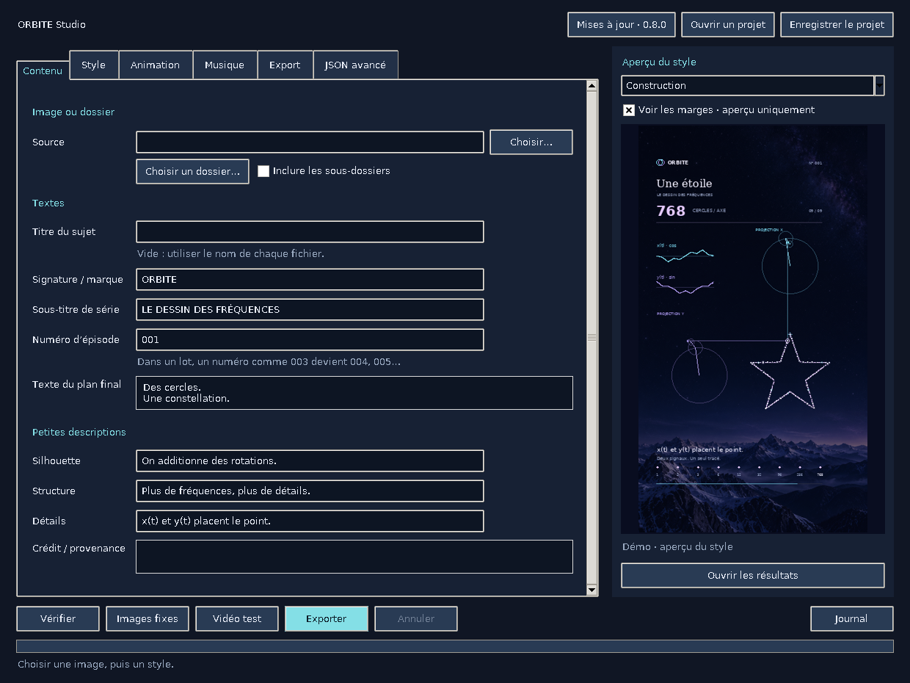

# ORBITE Studio

Des cercles qui dessinent une image, une musique qui suit sa forme.

Application Python locale : dessin, logo, SVG ou photo → animation de Fourier
verticale, avec musique générative et identité visuelle personnalisable.

## Installation rapide

Installer **Python 3.10+ avec Tkinter**. Copier ces deux lignes dans le terminal :

**Windows — PowerShell :**

```powershell
curl.exe --fail --location https://raw.githubusercontent.com/OxideurZ/Orbite-studio/main/install.py -o install_orbite.py
py -3 install_orbite.py
```

**macOS / Linux :**

```sh
curl --fail --location https://raw.githubusercontent.com/OxideurZ/Orbite-studio/main/install.py -o install_orbite.py
python3 install_orbite.py
```

Sous Debian/Ubuntu, installer d’abord `python3-venv`, `python3-tk` et `curl`.
L’installateur crée un environnement isolé, installe les dépendances et FFmpeg,
puis ouvre le GUI. **Git et un compte GitHub ne sont pas nécessaires.**

[Guide d’installation, lanceurs et dépannage](INSTALLATION.md)

## Mises à jour

Le GUI vérifie les nouveautés en arrière-plan au démarrage, au plus une fois
par heure. Cliquer **Mises à jour → Mettre à jour et redémarrer**. La session est
sauvegardée, la nouvelle version est installée séparément, puis l’application
redémarre avec les réglages. Aucune installation automatique sans clic.

Les projets, thèmes personnels et exports sont séparés du code. En cas d’échec,
l’ancienne version reste active. Un bouton permet de revenir à la version
précédente. Les mises à jour suivent les commits publiés sur `main`.

## Fonctionnalités

- Image seule ou dossier d’images ; SVG et dessins au trait recommandés.
- Textes, étapes de Fourier, cercles et durées personnalisables.
- Styles Cosmos, Aurore, Papier, fond personnel et palette suggérée.
- Six couleurs, trois polices et tous les réglages JSON existants.
- Musique par image : Orbite, Brume, Cristal ou motif classique.
- Écoute audio seule avant de produire une vidéo.
- Export vertical 1080 × 1920 ou 1440 × 2560, cadence personnalisable.
- Projets enregistrables et thèmes importables/exportables.

Les marges sociales sont **désactivées par défaut** et activables dans Animation.
Les photos sont converties en contours ; contrôler les images fixes avant export.



## Documentation

- [Utiliser le GUI](STUDIO.md)
- [Personnaliser les thèmes](THEMES.md)
- [Musique : méthodes, publications et réglages](MUSIQUE.md)
- [Historique des versions](CHANGELOG.md)

## Développement et ligne de commande

```sh
python -m venv .venv
# Activer .venv selon le système, puis :
python -m pip install -r requirements.txt
python -m unittest discover -v
python studio.py --no-update-check
python orbite.py examples/etoile.svg --check
python orbite.py mon_image.png --stills
python orbite.py mon_image.png --audio-only
python orbite.py mon_image.png
```

Les tests Tk sont ignorés sans écran graphique. Les tests de mise à jour
contrôlent les échecs, le retour arrière et la conservation des données.
Les images et vidéos restent sur l’ordinateur : aucun portrait personnel ni
export utilisateur n’est publié dans ce dépôt. Les exemples sont génériques.

## Licence et crédits

Code et documentation : [MIT](LICENSE). Polices DejaVu : licence dans `fonts/`.
FFmpeg et [imageio-ffmpeg](https://github.com/imageio/imageio-ffmpeg) conservent
leurs licences respectives. Le paysage étoilé est généré pour le projet.

L’exemple `gondor.svg` provient de
[Escudo Gondor.svg sur Wikimedia Commons](https://commons.wikimedia.org/wiki/File:Escudo_Gondor.svg),
crédits Vëon Menelion et Luigi Chiesa, fichier classé domaine public sur sa page.
Les autres exemples géométriques sont créés pour ORBITE Studio.
